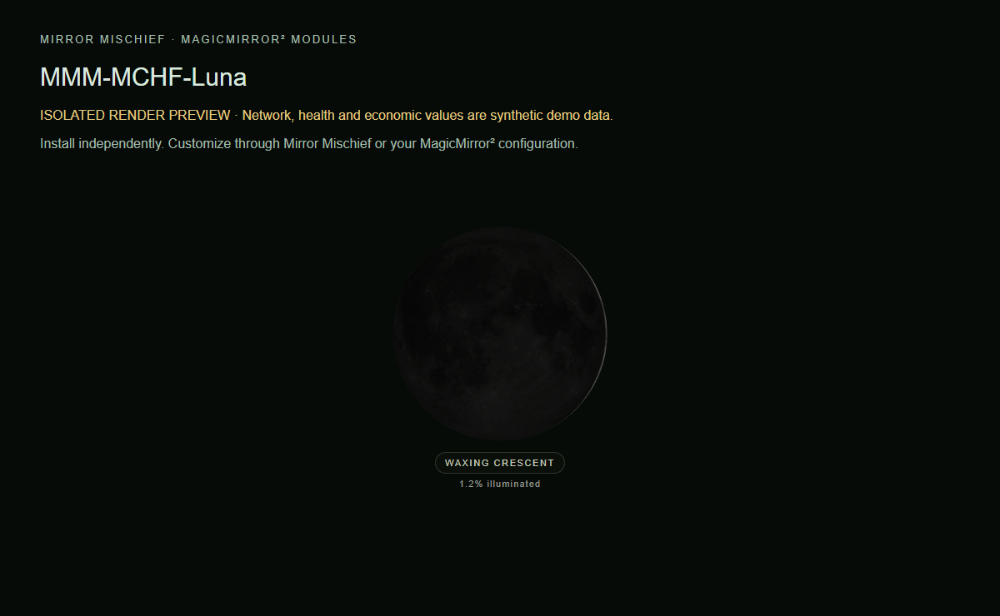

# MMM-MCHF-Luna

A NASA-textured Moon with continuous local phase lighting.

Part of [Mirror Mischief](https://github.com/FoggEyez/Mirror-Mischief). Install and configure manually, or use the optional companion.



Screenshot uses the actual module renderer in an isolated preview. Network/health/economy readings are labelled synthetic demonstration data, not live readings.

## Install

Requires a working MagicMirror² installation, Node.js 22 or newer, and a current browser. Development baseline: MagicMirror² 2.38.0 API. Physical-device compatibility of this newly packaged version remains to be verified; see VALIDATION.md.

```sh
cd ~/MagicMirror/modules
git clone https://github.com/FoggEyez/MMM-MCHF-Luna.git
```

No npm runtime dependencies or install scripts. No extra services are required.

Add this to the modules array in config/config.js, then restart MagicMirror²:

```js
{
  module: "MMM-MCHF-Luna",
  position: "middle_center",
  config: {}
}
```

## Customize

Choose `diameter` (140–440 pixels), `brightness` (20–150), and `earthshine` (0–25). `hemisphere` is north or south; south rotates the disc 180 degrees. `autoFit` optionally fits bottom-left placement beneath upper-left modules. Earthshine is an aesthetic dark-side adjustment. The fixed texture does not simulate libration, terrain shadows, eclipses or local horizon tilt.

All supported settings are visible as literal defaults for generated settings editors.

| Setting | Default | Type |
| --- | --- | --- |
| diameter | `260` | number |
| autoFit | `true` | boolean |
| brightness | `100` | number |
| earthshine | `12` | number |
| hemisphere | `"north"` | string |
| showTitle | `false` | boolean |
| showPhase | `true` | boolean |
| showIllumination | `true` | boolean |

## Mirror Mischief companion

Part of [Mirror Mischief](https://github.com/FoggEyez/Mirror-Mischief), a companion designed to make module installation, settings and layout easier. See [MIRROR-MISCHIEF.md](MIRROR-MISCHIEF.md) for setup and availability.

In Mirror Mischief, choose Install from a link, paste this repository URL, then open Module settings. Set your preferences and position, save and run Check setup. The repository folder, JavaScript entry and Module.register name match exactly. companion.json describes supported placement and dependencies; the current companion reads defaults from JavaScript, not this manifest. One instance per mirror is supported in this release; helpers share one configuration per module. For renamed legacy modules, install this version turned off first and disable the legacy counterpart before enabling it. Moon and Quotes retain their existing names: back up and review any local changes before updating their existing folders. No automatic config migration or removal occurs. Ordinary MagicMirror² configuration works without the companion.

## APIs, privacy and cost

None at runtime. Offline with bundled NASA texture and astronomy code; no API key or account.

No telemetry or analytics is added by Mischief. Keep private configuration, tokens and collector snapshots outside this repository.

## Update or remove

Review CHANGELOG.md, back up your private config and local customizations, then run git pull --ff-only inside this module folder and restart MagicMirror². To remove, disable/remove its config entry and restart; retain the folder for rollback or uninstall it using your companion. Never overwrite private configuration from an example.

## Development and support

Run npm ci and npm test. See CONTRIBUTING.md and VALIDATION.md. Report reproducible issues through this repository's Issues tab; remove secrets and private addresses.

## Credits and license

Astronomy routines from [MMM-NightSky](https://github.com/charleswest775/MMM-NightSky), Copyright Charles West, MIT; retained in vendor/LICENSE-NightSky. Surface image: [NASA SVS CGI Moon Kit](https://svs.gsfc.nasa.gov/4720/), Ernie Wright / NASA / LRO / LROC. assets/moon-color.jpg is a JPEG conversion of lroc_color_poles_2k.tif. NASA describes the map as optimized for appearance rather than measurements. No NASA endorsement is implied.

Original Mischief code: MIT, Copyright 2026 FoggEyez. Third-party licenses and data credits remain applicable; see THIRD_PARTY_NOTICES.md.
